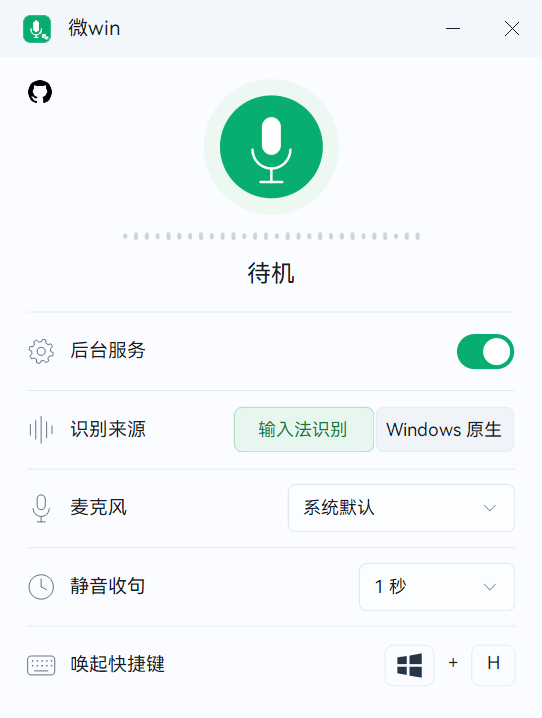

<div align="center">


# 微win

**开口，文字就位。**

保留 Windows 原生 **Win+H**，接入微信输入法云端语音识别。<br />
Rust 原生实现 · 边说边写 · 停顿收句 · 开口续听

<p>
  <a href="https://github.com/Elnyxn/weiwin/actions/workflows/windows.yml"></a>
  <a href="https://github.com/Elnyxn/weiwin/releases/latest"></a>
  <a href="LICENSE"></a>
  
  <a href="Cargo.toml"></a>
  <a href="https://github.com/Elnyxn/weiwin/stargazers"></a>
</p>

<p>
  <a href="https://github.com/Elnyxn/weiwin/releases/latest"></a>
  <a href="https://github.com/Elnyxn/weiwin/releases/latest"></a>
  <a href="https://github.com/Elnyxn/weiwin/issues"></a>
</p>

两个下载入口均前往最新发布页，按需选择 ZIP 或安装 EXE。

[快速开始](#快速开始) · [功能一览](#功能一览) · [检测更新](#检测更新) · [参与开发](#参与开发)

</div>

<p align="center">
  
</p>

> **需要联网，无需登录。** 默认后端独立完成匿名设备登记与会话协商，无需微信或微信输入法账号登录，也无需让这两个客户端常驻后台。语音识别由云端完成。

## 功能一览

| 能力 | 体验 |
| --- | --- |
| **熟悉的 Win+H** | 使用 Windows 原生语音输入面板，保留系统快捷键。 |
| **流式输入与修订** | 讲话时持续写入，识别和润色结果可修订当前文字。 |
| **停顿收句，开口续听** | 默认静音 **3 秒**收句；可选 **1 / 2 / 3 / 5 / 10 秒**。 |
| **选择麦克风** | 跟随系统默认设备，或指定输入设备；设置保存后**下次 Win+H 生效**。 |
| **控制面板与托盘** | 关闭窗口后继续运行；可切回微软识别，或从托盘正常退出。 |
| **Windows Terminal** | 支持流式尾部修订；手动编辑、回车或切换输入目标后停止补写。 |

## 快速开始

> [!IMPORTANT]
> 当前仅验证 **Windows 11 x64 build26300 的已适配系统组件**。程序会核对组件哈希；其他组件版本需要适配，不匹配时拒绝接管原生接口。

1. 前往 [最新发布页](https://github.com/Elnyxn/weiwin/releases/latest)，下载便携版或安装版。
2. 运行 **`微win.exe`**，开启「后台服务」，选择「输入法识别」。
3. 在输入位置按 **Win+H**，开始讲话。停顿后自动收句，继续讲话自动续听。

| 发行文件 | 使用方式 |
| --- | --- |
| `weiwin-<版本>-windows-x64-portable.zip` | 解压后运行，适合自行管理程序目录。 |
| `weiwin-<版本>-windows-x64-setup.exe` | 安装到当前用户目录，创建开始菜单及可选桌面快捷方式。 |
| `SHA256SUMS.txt` | 提供两种发行文件的 SHA-256 校验值。 |

选择「Windows 原生」可恢复微软识别。托盘「退出」会先恢复原生接口，再结束微win。向**管理员窗口或管理终端**输入时，请以管理员身份运行微win。

### 设置与数据

用户设置与匿名设备身份保存在 `%LOCALAPPDATA%\WeChatWinH`；升级和卸载会保留这些数据。麦克风与静音时间更改后，下次唤起 Win+H 生效。设备名称读取 Windows 真实主机名。

发布包包含程序和版本化桥接 DLL，**不包含**设备身份、连接凭据、录音、日志或调查工具。默认后端不会读取聊天内容。

## 检测更新

启动后自动检查，之后每 **6 小时**检查一次；右键窗口左上区域的 **GitHub 图标 → 检查更新**，也可手动检查。检查在后台进行，不阻塞输入。

只有新版本的便携包和安装包都已发布完整，才会出现更新提示。

| 操作 | 行为 |
| --- | --- |
| **下载更新** | 打开该版本的发布页，自行选择便携版或安装版。 |
| **跳过此版本** | 持久保存该版本的跳过选择；后续新版本仍会提示。 |
| **关闭提示** | 本次运行不再自动弹出该版本提示；手动检查仍可查看。 |

安装与卸载会请求本程序正常退出并确认 Windows 原生识别已恢复；不会结束微信、输入法或 TextInputHost 进程。

## 参与开发

欢迎通过 [Issue](https://github.com/Elnyxn/weiwin/issues) 反馈体验问题，通过 [Pull Request](https://github.com/Elnyxn/weiwin/pulls) 参与改进。

反馈时请提供 Windows 版本、系统 build 和最短复现步骤；分享日志前请移除凭据及设备身份，勿公开录音。

### 本地构建

Windows 构建需要 **Rust MSVC、Visual Studio C++ 构建工具与 Windows SDK、CMake**；生成安装包还需要 **Inno Setup 6**。Python 3 仅参与构建检查，不进入发行包。

```powershell
cargo test --workspace
cargo build --release --target x86_64-pc-windows-msvc

# PowerShell 7：构建、检查并生成便携版与安装版
./packaging/build-windows.ps1
```

完整工具要求、静态 CRT 检查和安装契约见 [Windows 构建与发布](packaging/README.md)。

### 自动构建与发布

[Windows CI](.github/workflows/windows.yml) 在 **push / Pull Request** 时运行检查并构建双包。推送与 Cargo 版本一致的 **`vX.Y.Z`** 标签后，发布流程先上传便携 ZIP、安装 EXE 与校验文件，确认完整后才公开 Release 并设为 Latest。

---

<div align="center">

由 <a href="https://github.com/Elnyxn">Elnyxn</a> 维护 · <a href="LICENSE">MIT License</a><br />
如果微win让你的表达更顺手，欢迎留下一个 <a href="https://github.com/Elnyxn/weiwin/stargazers">Star</a>。

</div>
